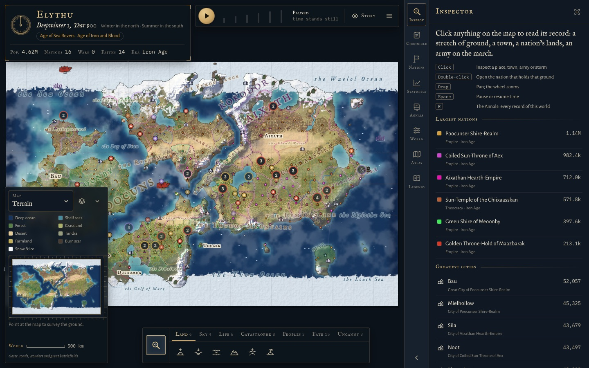
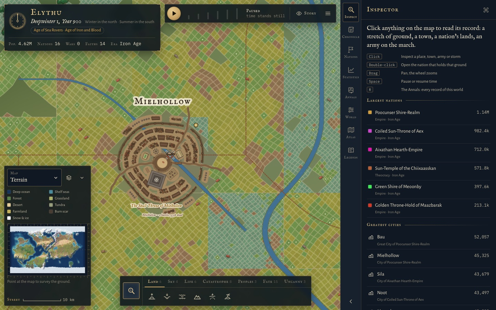

# Atlas of Ages

A world simulator that runs by itself. You set the conditions of a new planet, and history unfolds one simulated day at a time: continents and climate, forests and herds, tribes that become empires, trade, faiths, plagues and wars. Left alone, the same seed and settings replay the same history in the same browser. You can watch, read the record, or step in with god tools and undo what you did.

**[Play in your browser](https://magitekzed.github.io/atlas-of-ages/)** · **[Single-file download](https://magitekzed.github.io/atlas-of-ages/atlas-of-ages.html)** (right-click and choose Save Link As; the saved file plays offline by double-click)



## Features

- **The world.** Plate tectonics, erosion and rivers shape the land. Seasons, rain, storms, ice and sea level change over time. Forests, herds, predators and fish rise and fall. Quakes, eruptions, floods, wildfires and falling stars strike.
- **Peoples.** Tribes found towns that grow into cities and nations, with rulers, dynasties, governments, technology, roads, treaties and wars. Outlaws, pirates, mercenary companies and hordes roam between them.
- **Three ages.** A world is Historical (people only), Legendary (omens, saints and haunted ruins that live in belief) or Mythic. A Mythic world adds elves, dwarves, orcs, halflings and lizardfolk living in mixed towns, ley lines and magic, gods who answer prayers, dragons and other beasts, and magic that fades as industry rises.
- **Story tools.** The Director is a camera that follows the story and captions it. Run until stops time at the next war, fall of a nation, plague or new era. You also get a digest of each leap, a history timeline, a watchlist, pinned views and follow.
- **Records.** Every town, nation, war, ruler, dynasty, faith, plague, storm, band and site has its own dossier. There is also the Chronicle, the Annals and Hall of Records, a Nations ledger, Statistics, and an Atlas of past borders.
- **God tools.** Seven groups of tools, from raising mountains to inciting wars, plus acts on single rulers, realms and towns. Each tool previews what it will hit before you click. You can undo your acts, rewind history, and keep the future you left as a branch save.



## Controls

| Input | Action |
|-------|--------|
| Space | Pause or resume |
| 1–6 | Speed: Slow, Normal, Fast, Faster, Rapid, Max |
| Drag, wheel | Pan, zoom |
| Click, double-click | Inspect; zoom in (on a town, dive down to it) |
| Right-click or long-press | Everything under the pointer, and what you can do there |
| / or Ctrl/Cmd+K | Find anything |
| G | The Director |
| U, J | Run until something happens; leap ahead |
| Ctrl/Cmd+Z | Undo your last act |
| ? | Every key |

The full list is in the [guide](docs/guide.md#keyboard-and-mouse).

## Run from source

The source is plain ES modules, so it needs a web server, not a double-click:

```bash
python3 -m http.server 8765 --bind 127.0.0.1
```

Then open http://127.0.0.1:8765/. `npm run serve` runs the same command.

## Build the single file

```bash
node tools/build-standalone.mjs
```

This writes `Atlas of Ages.html`, which bundles every module and stylesheet into one page. It uses esbuild through `npx`, so nothing is installed into the project. Pushes to `main` build and publish the site automatically ([development guide](docs/development.md#deployment)).

## Documentation

- [How to play](docs/guide.md)
- [How it works](docs/architecture.md)
- [Development](docs/development.md)
- [Docs index](docs/README.md)

The source is under `src/` (kernel, world generation, simulation, renderer, UI). Tools are under `tools/`. See [architecture](docs/architecture.md#where-things-live) for the layout.
