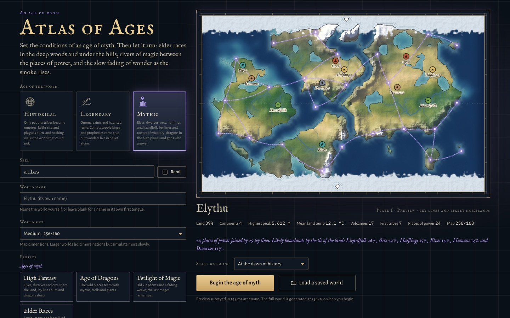

# How to play

Atlas of Ages has no goal. You make a world, then watch its history, read it, and step in when you want to. The [hosted page](https://magitekzed.github.io/atlas-of-ages/), the downloaded single file and the source served locally are the same game.

## Genesis

**The age of the world** is the first choice:

- **Historical.** Only people.
- **Legendary.** Omens, saints and haunted ruins. Prophecies come true, but wonders live only in belief.
- **Mythic.** Six peoples: humans, elves, dwarves, orcs, halflings and lizardfolk. Also ley lines and mana, arcane schools, dragons and other beasts, the undead, and gods who answer. The preview shows the ley network and where each people is likely to start.

**The seed** decides everything that is left to chance. In the same browser, the same seed and settings always give the same world and the same history. Reroll draws a new seed. **World name** is optional; if you leave it blank, the world is named in its own first language.

**Presets** set many parameters at once. The land presets keep the age you chose: Earthlike, Pangaea, Archipelago, Ice Age, Hothouse, Desert World, Waterworld, Highlands, Peaceful Garden, Age of Strife and Cataclysm. The age presets set the age too: High Fantasy, Age of Dragons, Twilight of Magic and Elder Races (Mythic), and Legends (Legendary).

**Parameters.** There are about 50, in six groups: Land & Sea, Climate, Life, Peoples, Catastrophe, and Myth & Magic. The Myth & Magic sliders appear when the age needs them. These have the most effect:

- *World size*: Small 192×120, Medium 256×160, Large 320×200, or Vast 400×250 tiles. A tile is about 20 km. Larger worlds hold more nations but run more slowly.
- *Ocean coverage*, *Continents*, *Mountain height* and *Tectonic plates* shape the land.
- *Global temperature* and *Rainfall* set the climate.
- *First tribes* and *Starting era* (Stone, Bronze, Iron or Classical Age) set how history begins.
- *Aggression*, *Expansion*, *Religiosity*, *Trade* and *Political stability* set how the peoples behave.
- *Disaster frequency* and *Plague outbreaks* set how much goes wrong.
- *Magic*, *Monsters*, *Gods answer*, *Peoples of the world* and *The Fading* tune a Mythic world.

The size, the shape of the land, the first tribes, the starting era, the age and the mix of Mythic peoples are set at genesis. Everything else can be changed later in the World tab.

**Start watching** begins at the dawn of history or after 100, 250, 500 or 1,000 years have already run. **Load a saved world** opens your saves. If you played before, a **Continue** card offers the world you left.

## Watching

- **Time.** Space pauses and resumes. Keys 1–6 set the speed: Slow (2 days a second), Normal (8), Fast (30), Faster (120), Rapid (360) and Max (as fast as the device allows). Every day is simulated in full at every speed.
- **The HUD** shows the world's name, the date and season, the current ages (for example "Age of Sea Rovers"), and the population, nations, wars, faiths, active plagues and era.
- **The Director** (G, or Story on the time bar) takes the camera. It flies to battles, sieges, eruptions, plagues and other major events, and captions each one with its Chronicle entry. It slows time for action and runs quiet years at Rapid; you can turn this pacing off in its settings. If you move the map or select something yourself, it waits for 20 seconds before taking over again.
- **Leap ahead** (J) runs 10 to 1,000 years at full speed while the map keeps drawing. Esc or Stop ends the leap early.
- **Run until** (U) runs at full speed, up to 1,000 years, until something happens: the next war, a historic or epochal event, a nation falling or rising, a plague, a great disaster, a new era, the selected town changing hands, being besieged or growing, the selected ruler dying, news of what you watch, or a year you choose. Then time stops, the map flies there and the record opens. Shift+U runs until the same thing happens again.
- **Digests.** After a leap, or a run until that covers more than 20 years, a review card (for example "250 years in review") sums up what changed. Each line links to its record. The Annals keep one for every century.
- **Notices** (Contents › Options › Notices) set which kinds of news appear as letters, and at what importance. They also set what pauses time on its own; by default that is epochal events.
- **Sound** is off until you turn it on (Contents › Options › Sound, or the switch on the title page). Every sound is synthesised in the browser.

## Finding things

- **Find anything** (/ or Ctrl/Cmd+K) searches nations, towns, ruins, wars, faiths, plagues, great figures, wonders, places, bands, sites, map modes, tools and commands. Start with `>` for commands, tools and map modes only, `@` for places, or `#` to search the Chronicle's text. Enter flies there and opens the record. Alt+Enter opens it without moving the map, and Shift+Enter watches it.
- **The context menu** (right-click, or long-press on touch) lists everything under the pointer. From it you can inspect, follow, watch, pin the view, zoom in, run until something happens there, use your last god tool there, see the same land in the Atlas a century ago, or copy a link that rebuilds this world and view (as history would run without your acts).
- **Watch** (. or the star on a record) adds something to the watchlist, which holds up to eight. Watched things appear as chips under the world's title card, their news is gilded, and arrows at the edge of the map point to watched armies, storms and bands that leave the view. **Follow** (the eye on a record, or the context menu) keeps a moving army, storm or band centred, or keeps a nation, war, plague or faith framed. **Watch over this people** (the crown on a nation's record) makes it your patron people.
- **Pins.** B saves the current view, and Shift+1–9 flies back to a saved view.
- **The timeline** (Y) shows all of history as a strip with lanes for population and ages, wars, plagues, and great events. Click to open an event and show that decade in the Atlas, drag to scrub, and use the wheel to zoom.
- **Map modes** (M and Shift+M, or the map dock) are Terrain, Political, Elevation, Temperature, Rainfall, Biomes, Vegetation, Wildlife, Population, Religion, Culture, Technology, Trade, Disease, Tectonics, Resources, Devastation and Pollution. Mythic worlds add Arcane, Peoples and Monsters.
- **Zoom.** Detail deepens through six levels: World, Continent, Region, Province, Town and Street. Close in, towns are drawn from their real buildings and walls, each people in its own style. Double-click a town to dive down to it.

## Reading the record

The side panel holds the record. A key opens each tab, and `\` folds the panel away.

- **Inspector** (I). Click anything to open its dossier: a stretch of ground, a town, nation, army, war, faith, plague, storm, volcano, band, trade route, ruler, dynasty, figure, wonder, fire, site or continent. Dossiers have charts over time, a town's chain of owners, and in Mythic worlds the mix of peoples.
- **Chronicle** (C). Every entry history has written, with filters by category and importance and a search box. Click an entry to fly there.
- **Annals** (R). Four parts: the Almanac of everything that ever existed, the Hall of Records, the Centuries in review, and the Stream of empires.
- **Nations** (N). A ledger of living nations that you can sort, followed by the fallen nations with their lifespans. Pick two to four nations, or Shift+click their rows, to compare them side by side.
- **Statistics** (T). Population, climate, sea level, CO₂, forests and herds, wars and plagues over time. Drag across a chart to zoom it, or click it to travel to that year.
- **World** (P). Every live parameter, which you can change while the world runs. Each shows its genesis value and can be reset. The tab also lists what each system costs per simulated year.
- **Atlas** (L). Border maps taken every ten years. Scrub through them or play them as a timelapse. Looking into the past stops time.
- **Legends** (O, Legendary and Mythic worlds). The state of magic, the peoples of the world and of each continent and realm, the bestiary, the places of power, the arcane arts, and the miracles and tales. A Legendary world shows only its tales.

## Intervening

**God tools** are in the toolbelt at the bottom, in seven groups:

- **Shape the Land**: raise, lower, flatten, mountains, drown land, raise an island.
- **Command the Sky**: rain, drought, blizzard, lightning.
- **Tend Life**: bloom, forest, herds, predators, fish, wildfire.
- **Unleash Catastrophe**: storm, earthquake, volcano, falling star, tsunami, flood, locusts, plague.
- **Guide Peoples**: a new people, found a town, send settlers.
- **Weave Fate**: war and peace, alliances, trade routes, prophets, miracles, cures, discord and harmony, prosperity, enlightenment, unrest, ruin, ceding towns, royal marriages.
- **Stir the Uncanny**: ley lines, wellsprings and summoned beasts in a Mythic world. Awaken Magic turns any other world Mythic in the middle of its history.

Q and E step through the tools, and Esc returns to Inspect. Brushes keep working while you hold the button. [ and ] or Shift+wheel change the brush radius, and Alt+wheel changes its strength.

- **Previews.** Before you click, a tool shows what it will hit, and often an estimate of the toll. If it cannot act there, the cursor turns into a "no" sign and the hover card says why.
- **Pair tools** join two things, for example inciting a war, brokering peace or opening a trade route. Click the first, then the second. Esc lets go of the first pick.
- **Divine acts** live in a record's dossier. You can bless, curse or smite a ruler, grant an heir, depose, gift a technology, commission a wonder, rename, or read a town's or realm's fate and nudge what comes next. You can also send a hero against a beast or tame it. Drag a selected army or storm to send it somewhere.
- **Deed cards** report each act once, with Undo, Inspect and Watch.
- **Undo and rewind.** Ctrl/Cmd+Z undoes your last act and Ctrl/Cmd+Shift+Z redoes it. Undo replays history from just before the act, without it. Rewind history (the Contents, the Atlas or the timeline) returns to an earlier day. You can keep the future you left as a branch save. A dangerous act that cannot be undone asks for a second click.

## Saving

Contents › Save and load opens the Archive: worlds kept in browser storage slots, each with a map of its world, branches under the save they left. Ctrl/Cmd+S quick-saves. Options › Worlds can also save automatically every century (off by default). The game also keeps a resume copy as you play, so the title page can offer Continue. Export writes a `.atlas.json` (or `.atlas.json.gz`) file, and Import reads one back. Private windows and some embedded views block storage or downloads; importing a file always works.

The Contents (Esc with nothing to step back from, or the Menu handle) stops time while it is open. It holds Resume, Save and load, Rewind history, New World (or skip the rite with Default or Random), Options, Every key, and Return to the title. Options › Worlds also turns the forging of a new world on or off.

## Keyboard and mouse

| Input | Action |
|-------|--------|
| Space | Pause or resume (hold and drag to pan) |
| 1–6, 0 | Speed: Slow, Normal, Fast, Faster, Rapid, Max; 0 pauses |
| Drag | Pan (right or middle button always pans) |
| Wheel, + / − | Zoom |
| W A S D, arrows | Pan |
| Click | Inspect |
| Double-click | Zoom in; on a town, dive down to it; on held ground, open its nation |
| Right-click, long-press | Context menu |
| F | Show the whole world |
| Z | Frame the selection |
| M, Shift+M | Next or previous map mode |
| Tab, Shift+Tab | With the map focused: step through the largest towns and armies in view |
| Esc | One step back per press: drop a pair tool's first pick, return to Inspect, leave the Atlas's past view, clear the selection. With nothing to step back from, open the Contents. During a leap, stop it |
| Q, E | Previous or next god tool |
| [ and ], Shift+wheel | Brush radius |
| Alt+wheel | Brush strength |
| I C N T P L | Inspector, Chronicle, Nations, Statistics, World, Atlas |
| R | Annals |
| O | Legends (Legendary and Mythic worlds) |
| `\` | Fold or open the side panel |
| H | Hide or show the instruments |
| / or Ctrl/Cmd+K | Find anything |
| G | The Director |
| U, Shift+U | Run until; run until the same thing again |
| J | Leap ahead |
| Y | History timeline |
| . | Watch or unwatch the selection |
| B, Shift+1–9 | Pin this view; fly to a pinned view |
| Ctrl/Cmd+Z, Ctrl/Cmd+Shift+Z | Undo, redo |
| Ctrl/Cmd+S | Quick save |
| ? | The keyboard sheet |
| Touch | Drag to pan, pinch to zoom, tap to inspect, long-press for the context menu. On a phone, the tab bar along the foot opens the Dossier, Chronicle, Nations and Annals (More holds the other folios) and the god tools; the chips above it change the map mode and open Find |
